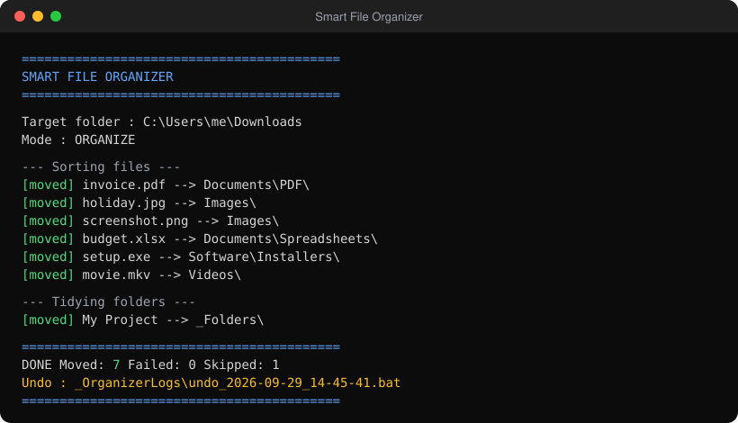

<p align="center">
  
</p>

<p align="center">
  
  
  
  
  
</p>

<p align="center">
  <b>A single <code>.bat</code> file that turns a messy Downloads or Desktop folder into a neat, categorized library.</b><br>
  Preview before it moves anything, undo with one click, nothing to install.
</p>

<p align="center">
  <a href="#-quick-start">Quick Start</a> •
  <a href="#-features">Features</a> •
  <a href="#-usage">Usage</a> •
  <a href="#-how-files-are-sorted">Categories</a> •
  <a href="#%EF%B8%8F-safety">Safety</a> •
  <a href="#-customize">Customize</a> •
  <a href="#-faq">FAQ</a>
</p>

---

## ✨ Features

| | |
|---|---|
| 🗂️ **Sorts by file type** | 100+ extensions mapped into clean folders, with sub-folders like `Documents\PDF` and `Software\Installers` |
| 👀 **Preview mode** | See exactly what would move before anything happens |
| ↩️ **One-click undo** | Every run writes an `undo_<date>.bat` that puts everything back |
| 🔒 **Never overwrites** | Name clashes become `photo (1).jpg`, `photo (2).jpg`, … |
| 📁 **Tidies folders** | Optionally gathers loose folders into `_Folders` |
| 🧹 **Cleans up** | Optionally deletes *empty* sub-folders (never ones with files) |
| 🛡️ **Safe by default** | Refuses system folders; skips hidden/system files and unfinished downloads |
| 🌐 **Unicode-friendly** | Handles names with spaces, `!`, `&`, accents and non-Latin characters |
| 📦 **Zero dependencies** | Pure Windows batch. No Python, no PowerShell modules, no installer |

<p align="center">
  
</p>

---

## 🚀 Quick Start

**1. Download the script**

- Click **[`organize_files.bat`](organize_files.bat)** → **Download raw file** (the ⬇ icon), **or**
- Clone the repo:
  ```bash
  git clone https://github.com/X-rajat/smart-file-organizer.git
  ```

**2. Run it on a folder** (pick one):

| Method | How |
|---|---|
| 🖱️ **Drag & drop** | Drag the folder you want to clean (e.g. `Downloads`) **onto** `organize_files.bat` |
| 🖱️ **Double-click** | Double-click the script, then paste or drag the folder path into the window |
| ⌨️ **Command line** | `organize_files.bat "C:\Users\you\Downloads"` |

**3. Answer the prompts**

```
 Preview only - show what would happen, move nothing? [Y/N]
 Move other existing folders into a '_Folders' folder? [Y/N]
 Delete EMPTY sub-folders afterwards? [Y/N]
 Continue? [Y/N]
```

> 💡 **First time?** Answer **Y** to *Preview only* to do a dry run. When you're happy with the result, run it again and answer **N**.

**4. Done!** Your folder now looks like this:

```
Downloads\
├── Documents\
│   ├── PDF\
│   ├── Word\
│   ├── Spreadsheets\
│   ├── Presentations\
│   ├── Text\
│   └── eBooks\
├── Images\
│   └── RAW\
├── Videos\
├── Audio\
├── Archives\
├── Software\
│   ├── Installers\
│   └── DiskImages\
├── Code\
├── Fonts\
├── Design\
│   └── 3D-CAD\
├── Torrents\
├── Shortcuts\
├── Others\            ← anything unrecognized
├── _Folders\          ← your existing folders (optional)
└── _OrganizerLogs\    ← log + undo script for every run
```

---

## 🧰 Usage

```bat
organize_files.bat "<folder>" [/preview] [/folders] [/clean] [/yes]
```

| Switch | Description |
|---|---|
| `/preview` | Dry run: show what would happen, move nothing |
| `/folders` | Move other existing folders into `_Folders` |
| `/clean` | Delete **empty** sub-folders afterwards |
| `/yes` | Don't ask any questions (only the switches given are used) |
| `/help` | Show usage |

**Examples**

```bat
:: Preview what would happen to Downloads
organize_files.bat "%USERPROFILE%\Downloads" /preview /yes

:: Full clean-up of the Desktop, no questions asked
organize_files.bat "%USERPROFILE%\Desktop" /folders /clean /yes
```

### ⏰ Run it automatically (optional)

Keep Downloads tidy every day with **Task Scheduler**:

1. Press <kbd>Win</kbd> + <kbd>R</kbd>, type `taskschd.msc`, press <kbd>Enter</kbd>
2. **Create Basic Task…** → name it `Organize Downloads` → **Daily**
3. Action: **Start a program**
   - Program: `C:\Tools\organize_files.bat` *(wherever you saved it)*
   - Arguments: `"%USERPROFILE%\Downloads" /yes`
4. Finish ✅

---

## 🗃️ How files are sorted

| Folder | Extensions |
|---|---|
| `Documents\PDF` | pdf |
| `Documents\Word` | doc, docx, docm, dot, dotx, odt, rtf, pages, wps |
| `Documents\Spreadsheets` | xls, xlsx, xlsm, xlsb, ods, csv, tsv, numbers |
| `Documents\Presentations` | ppt, pptx, pptm, pps, ppsx, odp, key |
| `Documents\Text` | txt, md, log, tex, nfo |
| `Documents\eBooks` | epub, mobi, azw, azw3, djvu, fb2, cbr, cbz |
| `Images` | jpg, jpeg, jfif, png, gif, bmp, tif, tiff, webp, heic, heif, avif, ico, svg |
| `Images\RAW` | raw, cr2, cr3, nef, arw, dng, orf, rw2, raf |
| `Videos` | mp4, mkv, avi, mov, wmv, flv, webm, m4v, mpg, mpeg, 3gp, vob, mts, m2ts |
| `Audio` | mp3, wav, flac, aac, ogg, oga, wma, m4a, opus, aiff, aif, mid, midi, amr |
| `Archives` | zip, rar, 7z, tar, gz, tgz, bz2, xz, zst, cab, lzh |
| `Software\Installers` | exe, msi, msix, msixbundle, appx, appxbundle, apk, xapk, dmg, pkg, deb, rpm |
| `Software\DiskImages` | iso, img, vhd, vhdx, vmdk, ova, ovf, qcow2 |
| `Code` | py, ipynb, js, mjs, ts, jsx, tsx, html, htm, css, scss, java, c, cpp, h, hpp, cs, go, rs, php, rb, swift, kt, sh, ps1, bat, cmd, vbs, sql, json, xml, yaml, yml, toml, ini, cfg, r, lua |
| `Fonts` | ttf, otf, woff, woff2, fon |
| `Design` | psd, ai, xd, fig, sketch, indd, eps, cdr, afdesign, afphoto |
| `Design\3D-CAD` | blend, obj, fbx, stl, 3mf, dwg, dxf, skp, step, stp |
| `Torrents` | torrent |
| `Shortcuts` | lnk, url |
| `Others` | everything else, including files with no extension |
| *(left alone)* | crdownload, part, partial, download, tmp (unfinished downloads) |

---

## 🛡️ Safety

- **Preview first.** `/preview` shows every move without touching a file.
- **Undo anytime.** Open `_OrganizerLogs` and run the matching `undo_<date>.bat`.
- **No overwrites.** Duplicate names are renamed, never replaced.
- **Protected locations.** Refuses to run on `C:\`, `Windows`, `Program Files` and `ProgramData`. On a **drive root** or your **user profile** folder it only sorts loose files and leaves your folders alone.
- **Ignored files.** Hidden and system files, `desktop.ini`, `thumbs.db`, unfinished downloads, and the script itself.
- **Top level only.** Only files directly inside the chosen folder are sorted. Files inside sub-folders are never pulled out, so project folders stay intact.
- **Empty-folder cleanup** uses `rd` without `/s`, which physically cannot delete a folder that contains anything.
- **Full log.** Every move is recorded in `_OrganizerLogs\log_<date>.txt`.

---

## 🎨 Customize

All categories live in one block near the top of the script. Each line is a destination folder plus a list of extensions:

```bat
call :Reg "Images"            ".jpg .jpeg .png .gif .webp"
call :Reg "Documents\PDF"     ".pdf"
```

- **Add an extension:** append it to an existing line, e.g. `.jxl` on the `Images` line.
- **Add a category:** add a new line, e.g. `call :Reg "Photoshop" ".psd .psb"`.
  If it creates a **new top-level folder**, also add its name to the `ROOTS` list so `/folders` never moves it.
- **Skip an extension:** add it to the `__SKIP__` line.

> ⚠️ **Keep Windows (CRLF) line endings** when editing. Notepad does this automatically. A file saved with Unix (LF) endings makes `cmd.exe` misread labels and misbehave. This repo's `.gitattributes` keeps them correct when you clone.

---

## ❓ FAQ

<details>
<summary><b>Windows SmartScreen warns me when I run it</b></summary>

That's normal for any downloaded script. Click **More info → Run anyway**, or right-click the file → **Properties** → tick **Unblock** → **OK**. The script is plain text, so you can open it in Notepad and read every line first.
</details>

<details>
<summary><b>A file shows <code>[FAILED]</code></b></summary>

It is open in another program, or you don't have permission to move it. Close the program and run the script again. Already-sorted files are not touched twice.
</details>

<details>
<summary><b>Can I run it more than once?</b></summary>

Yes. Each run only sorts new loose files, and each run gets its own log and undo script.
</details>

<details>
<summary><b>Why does <code>.ts</code> go to Code and not Videos?</b></summary>

`.ts` is far more commonly TypeScript than MPEG transport stream. Move it to the `Videos` line if you prefer.
</details>

<details>
<summary><b>Does it work on Windows 7/8?</b></summary>

It is tested on Windows 10 and 11. Older versions will mostly work, but the Unicode console output may look garbled.
</details>

---

## 🤝 Contributing

Suggestions and pull requests are welcome, especially new file types.

1. Fork the repo
2. Create a branch: `git checkout -b add-new-types`
3. Test with `/preview` on a throwaway folder
4. Commit and open a Pull Request

---

## 📄 License

Released under the [MIT License](LICENSE). Free to use, modify and share.

<p align="center">Made with ☕ by <a href="https://github.com/X-rajat">@X-rajat</a>. If this saved you some clicking, give it a ⭐!</p>
